# MediMind: Project Documentation

CS0011 Final Project. This document follows the sections of `FINAL_CHECKLIST.md`. Every screenshot is a real one from the finished debug build, taken on the Android Studio emulator "Pixel 10 Pro API 37.1" (Android 17, API 37) on 2026-11-21. The pictures are in `docs/screenshots/`.

## 1. Project Title and Information

| Item | Value |
| --- | --- |
| Title | MediMind: A Medication Reminder and Intake Tracker |
| Category | Health and personal care. Database-driven Android application |
| Course | CS0011, Final Project |
| Language and tools | Kotlin, Android Studio, SQLite |
| Package | `com.example.medimind` |
| Version | 0.1 (debug build) |
| Repository | `CS0011-Final-Project`, branch `main` |
| Group | Group of 5 |

Team and roles (from `TEAM_STANDARD.md`):

| Member | Role |
| --- | --- |
| Dawn Andrei Pamesa | Reviews shared setup and merges pull requests; final test run, fixes and documentation |
| David Decano | Database, models, stock persistence and stock alerts |
| Clarence Dominick Canaria | Form, Detail and refill screens |
| Joboy Porras Jr. | Testing of deductions, corrections, permissions, thresholds, refills and overflow |
| Erold Jan P. Leocario | Diagrams, user guide and the first ten test cases (TC-01 to TC-10) |

## 2. Project Description and Overview

MediMind lets a user save each medicine with its dose and daily schedule. At each scheduled time the app shows a notification. The user taps Taken or Skip on the Today screen, and the app keeps a history. A report shows how many doses were taken, skipped and missed over the last 7 or 30 days. On top of the proposal, the user asked for optional stock tracking: the app subtracts a number of units for each dose taken and sends one notification when the stock gets low. All records stay on the phone in a SQLite database and remain after the app is closed.

The app is a reminder tool and record keeper. It does not give medical advice, and the Today and Report screens say so.

## 3. Problem Statement, Target Users and Objectives

**Problem.** People who take medicines every day, such as maintenance medicines for high blood pressure or diabetes, often forget a dose or cannot remember if they already took it. Paper lists and phone alarms do not record what was really taken, so nobody can see which doses were missed.

**Target users.**

- Adults and older adults who take daily medicines.
- Family members who help manage a relative's medicines.

**General objective.** To develop an Android application that helps users take their medicines on time and keep a reliable record of their intake.

**Specific objectives.**

1. Let users add, view, update and delete medicines and their daily schedules in a SQLite database.
2. Remind users at each scheduled time with a notification.
3. Record each dose as taken or skipped and show doses that were missed.
4. Show an adherence report for the last 7 and 30 days.
5. Provide clear validation, messages and empty states so the app is easy to use.

## 4. Application Features and Functional Requirements

| # | Feature | Functional requirement |
| --- | --- | --- |
| F1 | Medicine list | Show every medicine with dose, Active or Finished pill, dose times and stock status. Search by name and filter All, Active and Done. |
| F2 | Add and edit a medicine | Name, dose, instructions, start date, optional end date, one or more daily times, days of the week, optional stock tracking (stock, units per dose, low-stock threshold). |
| F3 | Medicine detail | Show schedule, dates, stock and the intake history. Buttons for Edit, Delete and Add refill. |
| F4 | Delete with confirmation | Delete the medicine, its times and its intake history after the user confirms. |
| F5 | Validation and messages | Required fields, length limits, dates, times, days, duplicate medicine, duplicate time, whole-number stock. Messages for success, error, empty lists and confirmations. |
| F6 | Today screen | List today's doses. Upcoming doses have no buttons. Due doses have Taken and Skip, and the user can change the choice for today. A progress bar shows doses taken. |
| F7 | Reminders | One notification "Time for ..." at each dose time. Tapping it opens Today. Alarms are set again after a restart. |
| F8 | Adherence report | Taken, missed and skipped counts for 7 or 30 days and a list of missed doses. |
| F9 | Stock tracking | Each new Taken subtracts the units per dose once, a correction restores it, a notification appears when the stock is at or below the threshold (once per low-stock episode), and Add refill raises the stock. |
| F10 | Looks | Light and dark theme, and the layouts keep working with a large system font. |

Non-functional requirements:

| # | Requirement | How it is met |
| --- | --- | --- |
| N1 | Data stays after the app is closed | SQLite database `medimind.db` on the device (TC-02) |
| N2 | No network and no account | The app has no internet permission |
| N3 | Works on Android 8.0 and above | `minSdk` 26, `targetSdk` 36; notification permission handled on Android 13 and above |
| N4 | Clear, accessible interface | Text in `strings.xml`, colors in `colors.xml`, large touch targets, readable in dark mode and at font scale 1.5 and 2.0 (TC-23, TC-24) |
| N5 | No crash on bad input | Validation in the form and the stock dialog; the odd-input pass in the test log found no crash |

## 5. Tools and Technologies Used

| Tool | Use |
| --- | --- |
| Kotlin | All app code |
| Android Studio and the Android SDK (compileSdk 36) | Build, emulator, debugging |
| SQLite through `SQLiteOpenHelper` | Local database, database version 4 |
| RecyclerView | Lists of medicines, doses and missed doses |
| Material Components 1.13 and AppCompat 1.7 | Buttons, dialogs, theme with light and dark mode |
| Kotlin coroutines | Database work off the main thread |
| `AlarmManager`, `BroadcastReceiver`, `NotificationManager` | Dose reminders and stock notifications |
| JUnit 4 | Unit tests in `app/src/test` |
| Gradle (wrapper) with JDK 21 | Command line build: `gradlew.bat assembleDebug testDebugUnitTest` |
| adb and the Pixel 10 Pro emulator | Test runs, screenshots, notification checks |
| Git and GitHub | Version control, one branch per feature |

## 6. System Architecture and Data Flow

The app has three layers, as planned in `ARCHITECTURE.md`. There is no extra layer between the screens and the database.

| Layer | Classes | Job |
| --- | --- | --- |
| Model | `Medication`, `Schedule`, `IntakeLog`, `DoseItem`, `AdherenceSummary`, `MedicationRow` | Plain data classes |
| Database | `DatabaseHelper` | Creates the tables and has every read and write. Multi-row writes run in one transaction. |
| Screens | `TodayActivity`, `MedicationsActivity`, `MedicationFormActivity`, `MedicationDetailActivity`, `ReportActivity` with their adapters | Read input, validate, call the database, show the result |
| Helpers | `Validator`, `ScheduleTiming`, `DateUtils`, `Extras` | Validation rules, next-dose time, date text, Intent extra names |
| Reminders | `ReminderScheduler`, `ReminderReceiver`, `BootReceiver` | Alarms, notifications, restart recovery |

```
                +--------------------------------------------+
                |  Screens (Activities + RecyclerView)        |
                |  Today | Medications | Form | Detail | Report|
                +----+------------------+-------------+------+
                     | read / write     | schedule    | validate
                     v                  v             v
             +---------------+   +----------------+  +-----------+
             | DatabaseHelper|   |ReminderScheduler|  | Validator |
             | SQLite        |   | AlarmManager    |  +-----------+
             | medimind.db   |   +--------+--------+
             +---------------+            | alarm at dose time
                     ^                    v
                     |             +---------------+   tap    +-------+
                     +-------------+ReminderReceiver+--------->| Today |
                      reads dose   | (notification) |          +-------+
                                   +---------------+
        BootReceiver: after restart, time or time zone change, rebuilds the alarms.
```

Data flow for a dose:

1. The user saves a medicine in the Form. The Form validates, then `DatabaseHelper` stores the medicine and its schedules in one transaction, and `ReminderScheduler` sets an alarm for the next dose of each schedule.
2. At that time `ReminderReceiver` posts the notification "Time for ..." and sets the alarm for the next dose of the same schedule.
3. Tapping the notification opens Today with the schedule id and the dose date as Intent extras.
4. Today builds the list from the schedules (doses are not stored in advance). Taken or Skip writes one `intake_logs` row for the schedule and date, and a new Taken also subtracts the stock in the same transaction.
5. The Report counts the logs and treats a past dose with no log as missed.

## 7. Database Design and ERD

Database `medimind.db`, version 4. Foreign keys are enabled.

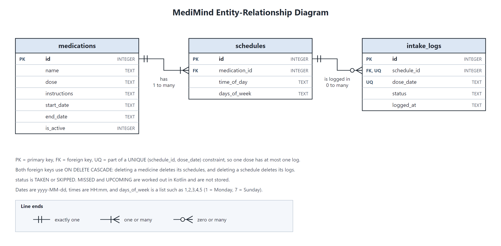

| Table | Fields |
| --- | --- |
| `medications` | `id` PK, `name`, `dose`, `instructions`, `start_date`, `end_date`, `is_active`, and the stock fields `stock_quantity`, `units_per_dose`, `low_stock_threshold`, `low_stock_notified` |
| `schedules` | `id` PK, `medication_id` FK to `medications.id` (delete cascades), `time_of_day` (HH:mm), `days_of_week` (for example 1,2,3,4,5,6,7). A medicine cannot have the same time twice. |
| `intake_logs` | `id` PK, `schedule_id` FK to `schedules.id` (delete cascades), `dose_date`, `status` (TAKEN or SKIPPED), `logged_at`, `stock_deducted`. One log for each schedule and date. |

Relationships: one medication has many schedules, and one schedule has many intake logs. Deleting a medicine deletes its schedules and logs (checked in TC-19).

Missed doses are not stored. A dose whose time has passed with no log is counted as missed when the Report or Today is built.

The full CREATE TABLE statements and the data format rules are in `DESIGN_DETAIL.md` (section 2) and `TEAM_STANDARD.md` (section 3).

## 8. UML Use Case Diagram

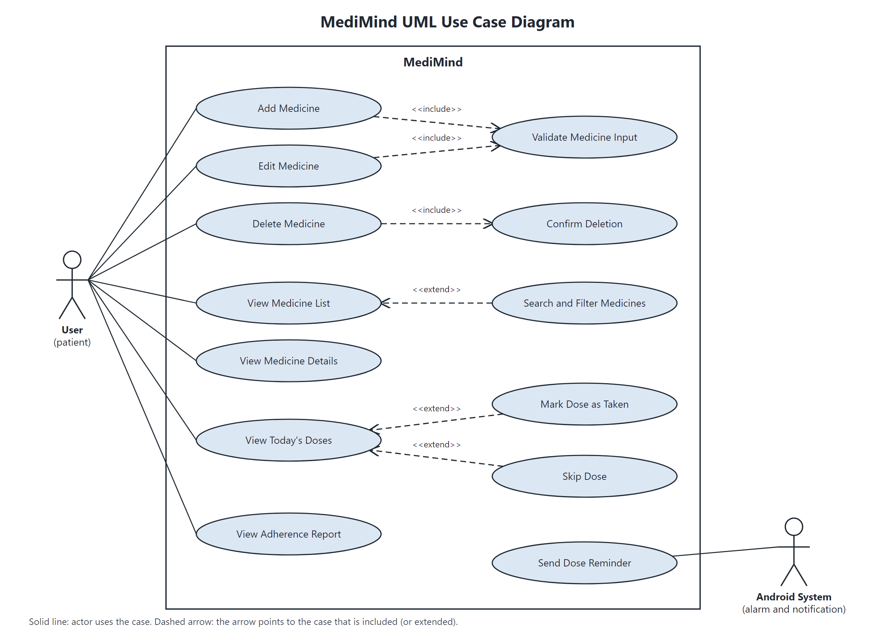

The user (the person who takes the medicine, or a family member helping) can manage medicines, record doses, view reports and receive reminders. The Android system starts the reminders at the set times and after a restart.

## 9. User Interface Design, Wireframes and Screen Navigation

Wireframes drawn before the build (`docs/wireframes/`):

| Today | Medications | Form |
| --- | --- | --- |
| 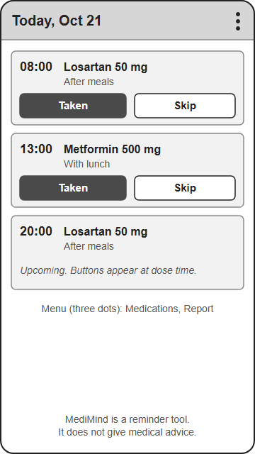 | 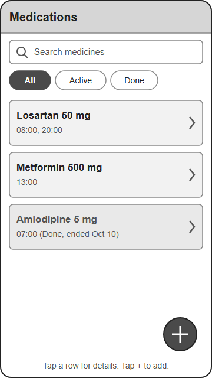 | 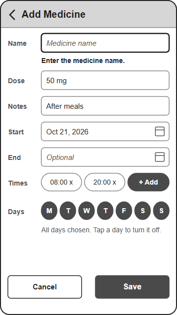 |

| Detail | Report | Empty state |
| --- | --- | --- |
| 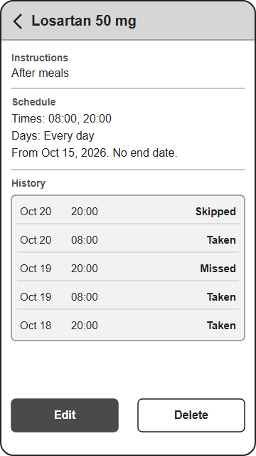 | 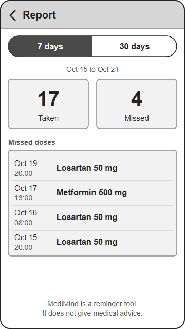 | 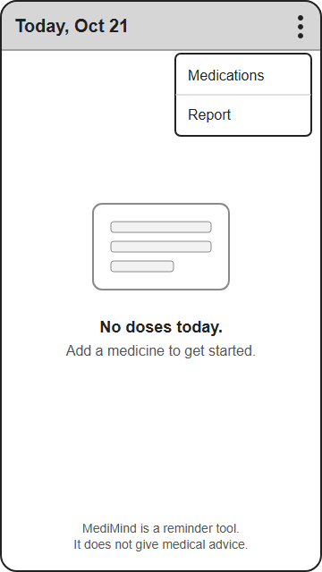 |

Screen navigation:

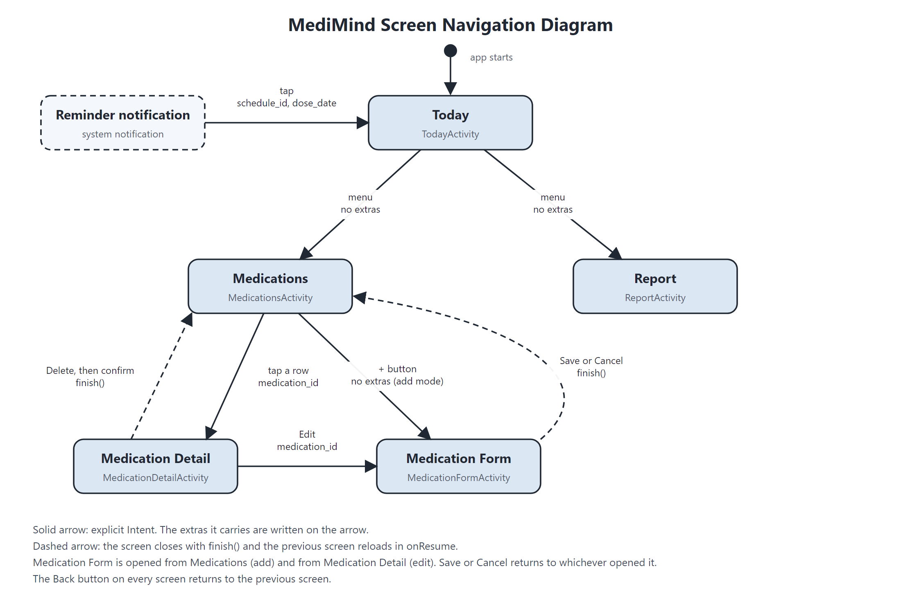

| Screen | Opens from | Intent and extras |
| --- | --- | --- |
| Today | App start, notification | The notification Intent carries `schedule_id` and the dose date. |
| Medications | Today menu | none |
| Medication Form | Medications (+), Detail (Edit) | `medication_id`; no id means add mode |
| Medication Detail | Medications list, stock notification | `medication_id` |
| Report | Today menu | none |

All screens are opened with explicit Intents. The finished screens use the same layout as the wireframes: a title block, cards with rounded corners, a green primary color and a dark theme (see section 10).

## 10. Application Screenshots and Feature Descriptions

| Screenshot | What it shows |
| --- | --- |
| 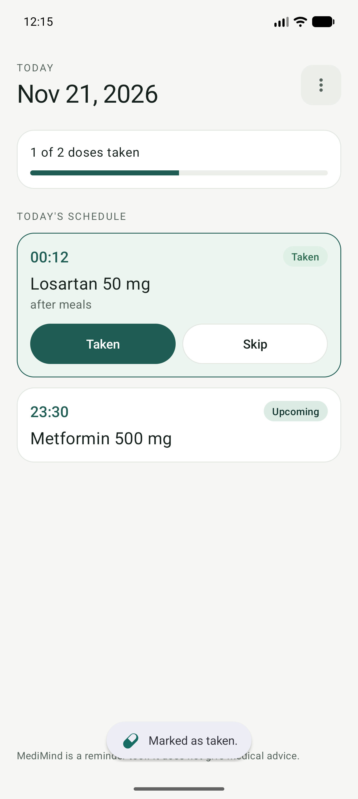 | **Today.** Date, a progress bar ("1 of 2 doses taken"), and one card per dose with the time, status pill, Taken and Skip buttons for a due dose. The upcoming dose (23:30) has no buttons. The toast "Marked as taken." confirms the tap. |
| 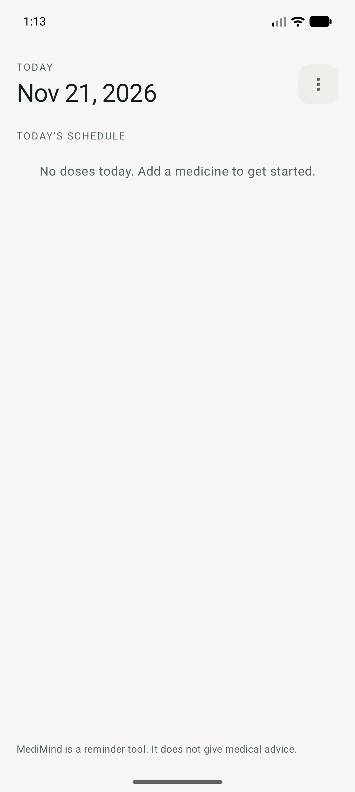 | **Today, empty state.** "No doses today. Add a medicine to get started." |
| 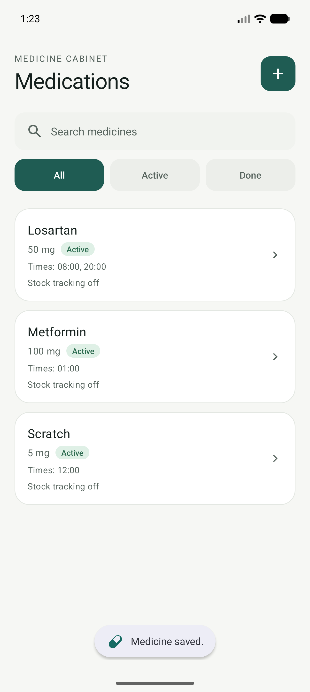 | **Medications.** Search box, filters All, Active and Done, and a card per medicine with the dose, status pill, dose times and stock status. The toast "Medicine saved." shows after saving. |
| 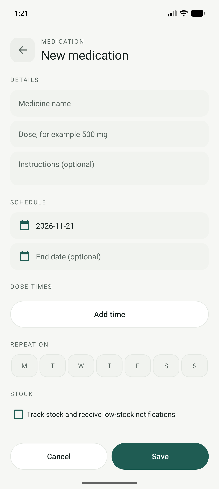 | **Add medication.** Name, dose, instructions, start and end date, dose times, days of the week and the stock tracking checkbox. |
| 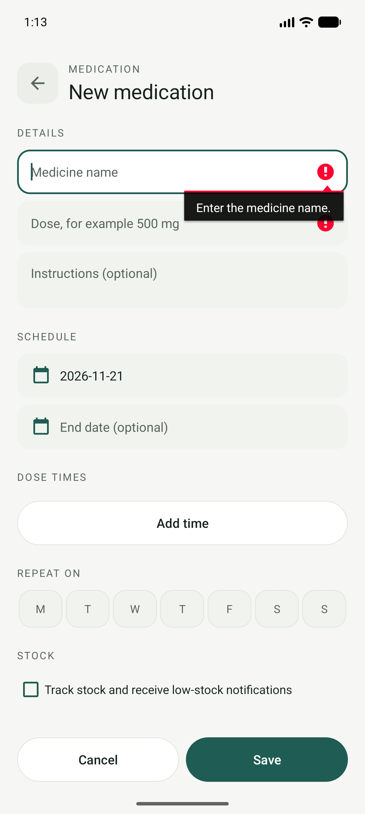 | **Validation.** An empty form is not saved; each required field shows its message. |
| 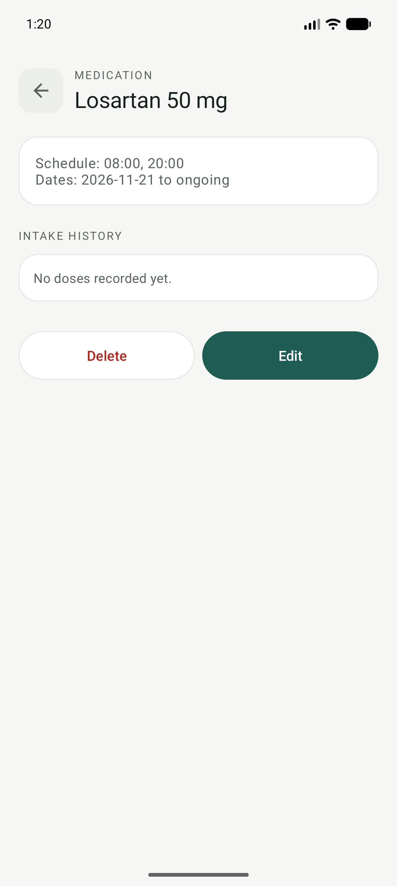 | **Medication Detail.** Schedule, dates and intake history with Delete and Edit buttons. |
| 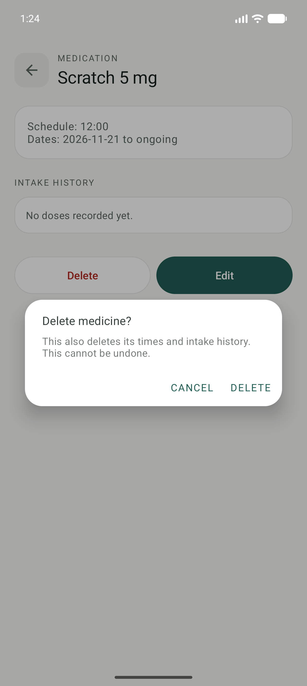 | **Delete confirmation.** "This also deletes its times and intake history. This cannot be undone." |
| 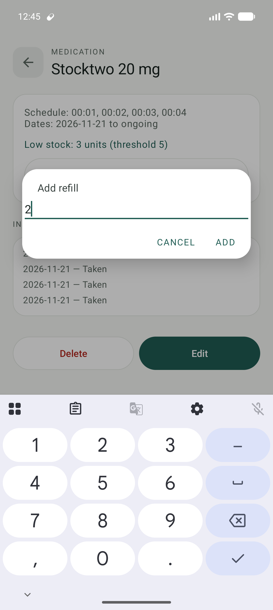 | **Stock and refill.** Detail shows the stock and the Add refill dialog asks for whole units. |
| 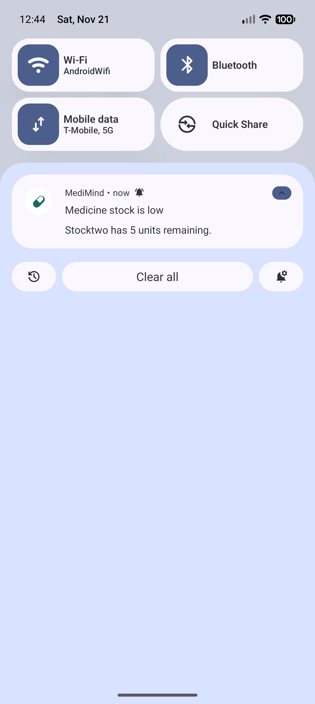 | **Low-stock notification.** "Medicine stock is low" when the stock reaches the threshold. |
| 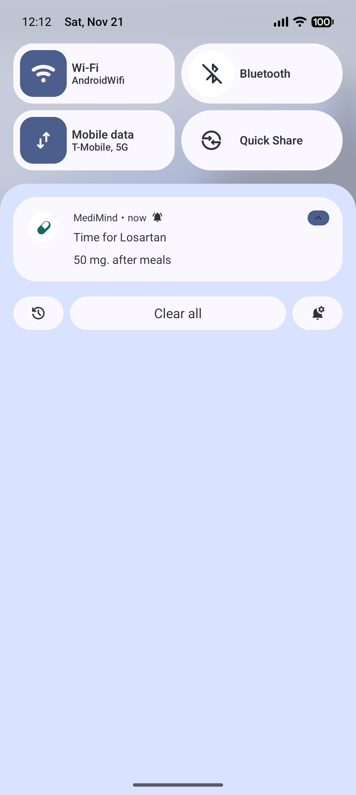 | **Dose reminder.** "Time for Losartan" with the dose and instructions. |
| 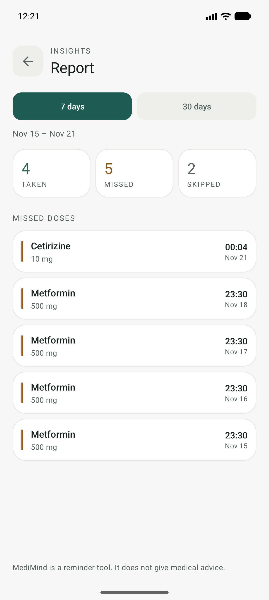 | **Report.** Taken, missed and skipped counts for 7 or 30 days and the list of missed doses. |
| 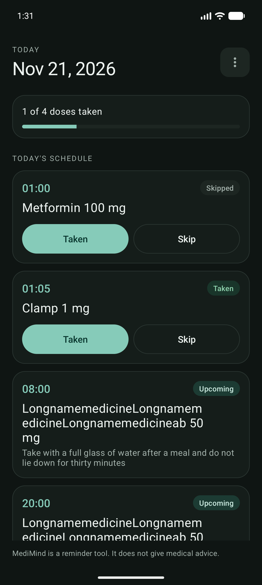 | **Dark theme.** Today in dark mode. |

## 11. Test Cases and Testing Results

29 test cases were run: TC-01 to TC-10 by Erold on 2026-11-20 (Pixel 4 API 37.0, results as he recorded them) and TC-11 to TC-29 on the emulator "Pixel 10 Pro API 37.1" on 2026-11-21. The full table with steps, expected and actual results, status, date, device and screenshot names is in `TEST_EXECUTION_LOG.md`, with a regression section and an extra pass on odd inputs.

| Group | Cases | Result |
| --- | --- | --- |
| Create, read, update, delete | TC-01 to TC-04, TC-19 | Pass |
| Validation | TC-05 to TC-07 | Pass |
| Empty states, Intents | TC-08 to TC-10 | Pass |
| Notifications and permissions | TC-11, TC-12, TC-18 | Pass |
| Taken, Skip, missed doses | TC-13, TC-14 | Pass |
| Report | TC-15 | Pass |
| Search and filter | TC-16, TC-17 | Pass (TC-17 after fix D-01) |
| Rotation | TC-20 | Pass (after fix D-03) |
| Stock tracking | TC-21, TC-22, TC-25 to TC-29 | Pass (TC-28 after fix D-02) |
| Dark mode and large font | TC-23, TC-24 | Pass |

Totals: **29 Pass, 0 Fail, 0 Inconclusive, 0 Pending.** Three cases failed on the first run (TC-17, TC-20, TC-28) and passed after their fixes. Unit tests (`gradlew.bat testDebugUnitTest`) pass.

## 12. Identified Defects and Implemented Corrections

Five real defects were found and fixed. Details, causes and retests are in `DEFECTS_AND_IMPROVEMENTS_LOG.md`.

| ID | Found in | Defect | Correction |
| --- | --- | --- | --- |
| D-01 | TC-17 | A medicine with a past end date showed the pill "Active" | One shared rule `Medication.isCurrentOn` for the pill and the low-stock check |
| D-02 | TC-28 | A stock number too large for an Int silently turned stock tracking off | `Validator.validateStockText` checks the typed text and shows an error |
| D-03 | TC-20 | Dose times were lost when the Form was rotated | The Form saves and restores the time list; the edit form no longer overwrites typed text |
| D-04 | TC-01 | The Medications list did not show the dose times | New `MedicationRow` and a times line in each card |
| D-05 | TC-08 | The Report empty state showed the "no missed doses" text instead of "No doses in this period yet." | The Report picks the right text when all counts are zero |

## 13. Application Improvements

| ID | Evidence | Improvement |
| --- | --- | --- |
| I-01 | TC-14: a time that already passed today was saved without a warning | The Form asks "Time already passed" and offers Go back or Save anyway |
| I-02 | TC-28: a refill overflow gave only a generic error | The refill dialog checks the number first and says what is allowed |

## 14. User Guide

### 14.1 About MediMind

MediMind keeps your medicine schedule, reminds you at each dose time and records whether you took or skipped the dose. It is for adults who take daily medicines and for family members who help them. MediMind is a reminder tool. It does not give medical advice.

### 14.2 Install and first start

1. Copy `app-debug.apk` to the phone and open it. If the phone asks, allow installs from this source.
2. Open MediMind. On Android 13 and above the Today screen shows the banner "Reminders are off. Turn on notifications to get reminders." with the button **Enable notifications**. Tap it and choose **Allow**.
3. If you choose Don't allow, the app still works but no notification appears. The button then opens the app notification settings, where you can allow them later.
4. If the phone asks for exact alarms, allow it. Without it, reminders can come a few minutes late.

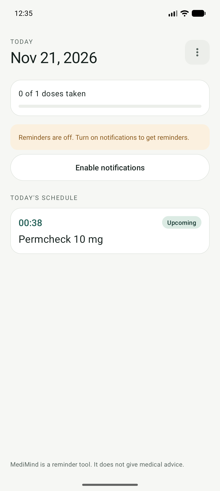
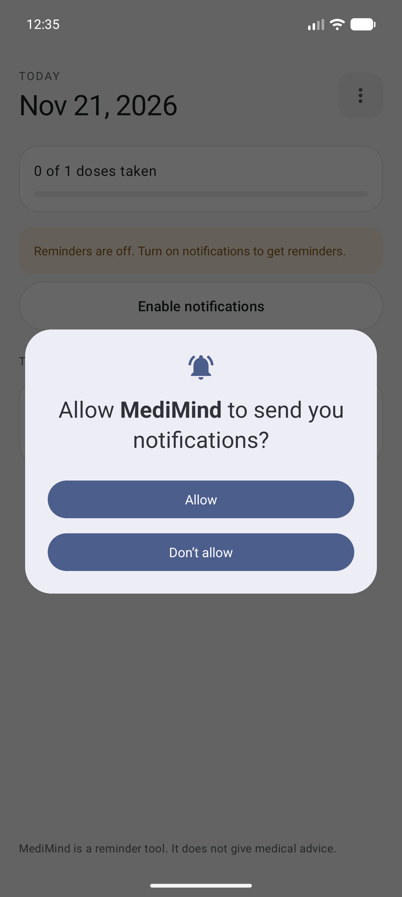

### 14.3 The Today screen

- Each card is one dose. The time and the status pill are at the top: **Upcoming**, **Not recorded** (the time has passed and you have not tapped anything), **Taken** or **Skipped**.
- A dose that is not due yet has no buttons.
- Tap **Taken** or **Skip** on a due dose. You can change your mind the same day by tapping the other button; the dose keeps one record.
- The menu (three dots, top right) opens **Medications** and **Report**.


### 14.4 Add a medicine

1. Open the menu, tap **Medications**, then tap **+**.
2. Fill in the fields:

| Field | Rule | Message if wrong |
| --- | --- | --- |
| Medicine name | Required, 2 to 50 characters | Enter the medicine name. / Name must be 2 to 50 characters. |
| Dose | Required, at most 30 characters | Enter the dose, for example 500 mg. |
| Instructions | Optional, at most 100 characters | Instructions must be 100 characters or fewer. |
| Start date | Required, not before today | Start date cannot be in the past. |
| End date | Optional, not before the start date | End date cannot be before the start date. |
| Dose times | At least one, no time twice | Add at least one time. / That time is already added. |
| Days | At least one day | Choose at least one day. |
| Stock (optional) | Tick the box. Stock is a whole number of units, units per dose at least 1, threshold at least 0 | Enter a remaining quantity of zero or more whole units. |

3. Tap **Add time** and pick each dose time. Tap the day buttons (M T W T F S S) to choose the days.
4. Tap **Save**. "Medicine saved." appears and the list shows the new medicine with its times.
5. If you add a time that has already passed today, the app asks "Time already passed". Tap **Go back** to change it or **Save anyway**. That dose then shows as Not recorded until you tap Taken or Skip.


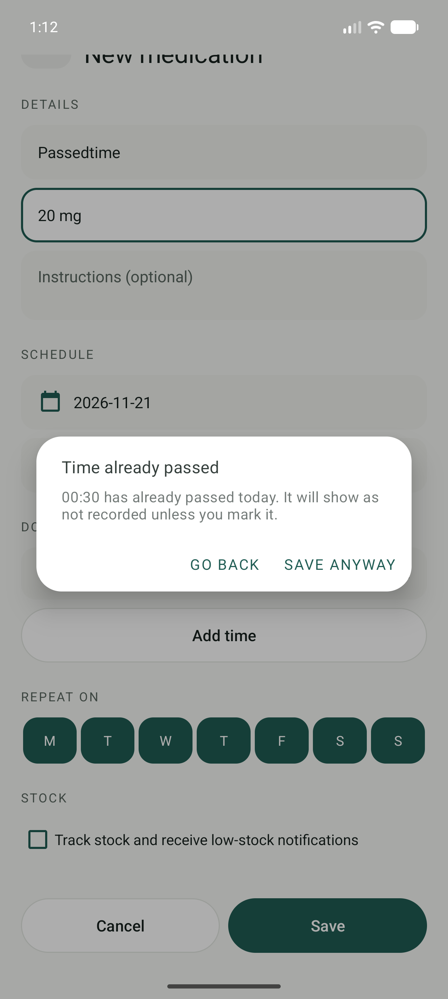

### 14.5 View, edit and delete a medicine

- Tap a medicine in the list to open its Detail: schedule, dates, stock and the intake history.
- **Edit** opens the form with the saved values. Change what you need and tap **Save**. "Medicine updated." appears. Earlier history stays.
- **Delete** asks you to confirm. It deletes the medicine, its times and its intake history, and it cannot be undone. "(name) deleted." appears.
- If you rotate the phone while the form is open, your typed text and chosen times stay.


### 14.6 Search and filter

- Type in the search box to see only medicines whose name contains the text. If nothing matches you see "No medicines match ...". Clear the box to see all again.
- **All**, **Active** and **Done** filter the list. Done shows medicines that were switched off or whose end date has passed; their pill says **Finished**.

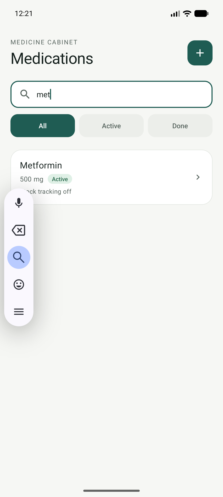
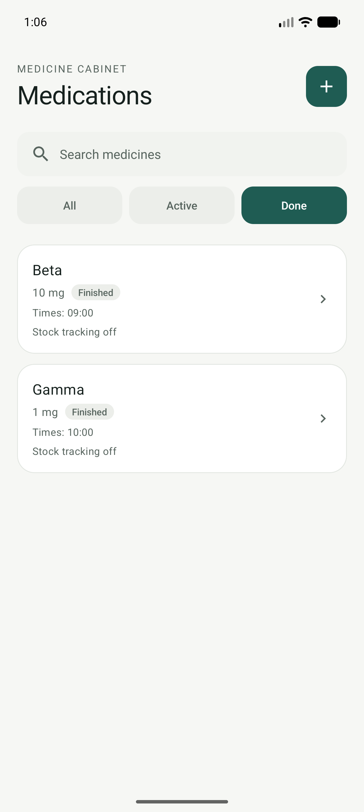

### 14.7 Stock and refills (optional)

- In the form tick **Track stock and receive low-stock notifications**. Enter the units you have, the units used for each dose and the threshold.
- Every new **Taken** subtracts the units for that dose. If you change a dose to Skip, the units come back.
- When the stock reaches the threshold, one notification "Medicine stock is low" appears. Tapping it opens the medicine. It is not repeated while the stock stays low.
- On the Detail screen tap **Add refill**, type a whole number and tap **Add**. If the new stock is above the threshold the alert is cleared.


### 14.8 Reminders

- At each dose time a notification "Time for (medicine)" appears with the dose and your instructions. Tap it to open Today.
- If a reminder does not come, check that notifications are allowed for MediMind, that exact alarms are allowed, and that battery saver is not stopping the app.
- After the phone restarts the reminders are set again by the app without opening it (checked in TC-18).


### 14.9 The Report

- Open the menu on Today and tap **Report**. Choose **7 days** or **30 days**.
- The three numbers are **Taken**, **Missed** and **Skipped** for that period. Below them is the list of missed doses. If you have no doses yet you see "No doses in this period yet."; if there are doses but none missed you see "No missed doses in this period."
- A dose is missed when its time has passed and you did not tap Taken or Skip.


### 14.10 Messages you may see

| Message | Meaning | What to do |
| --- | --- | --- |
| Medicine saved. / Medicine updated. / (name) deleted. | The action worked | Nothing |
| Marked as taken. / Marked as skipped. | Your dose was recorded | Tap the other button to change it |
| Could not save. Please try again. | The save failed | Try again |
| Reminders are off. Turn on notifications to get reminders. | Notification permission is off | Tap Enable notifications |
| Exact reminder times are off. Reminders may come a few minutes late. | Exact alarms are not allowed | Allow exact alarms in the phone settings |
| No doses today. Add a medicine to get started. | Today has no doses | Add a medicine |
| No medicines yet. Tap + to add one. | The list is empty | Tap + |
| No medicines in this list. | The filter has no match | Choose another filter |
| Delete medicine? | Confirmation before delete | Delete or Cancel |
| Discard changes? | You are leaving the form with changes | Discard or Keep editing |
| Time already passed | A new time is earlier than now today | Go back or Save anyway |
| Enter a positive whole refill quantity within the supported limit. | The refill number is not allowed | Type a whole number from 1 up |

### 14.11 Dark mode and large text

The app follows the phone's dark mode setting and its font size setting. Text stays readable and the Save, Cancel, Taken and Skip buttons stay reachable at larger font sizes.


### 14.12 Known limits

- Data stays on this phone only. There is no account and no backup. Uninstalling the app removes it.
- Reminders can be late when the phone saves battery, and the app does not promise an exact delay.
- A time saved for earlier today shows as Not recorded (and as missed in the Report) until you tap Taken or Skip.
- Older days are read-only; only today's doses can be changed.
- The Report shows counts only, not a percent.
- A very long name without spaces can wrap over several lines on small screens.
- Stock is an estimate you type in; the app does not predict when it will run out.
