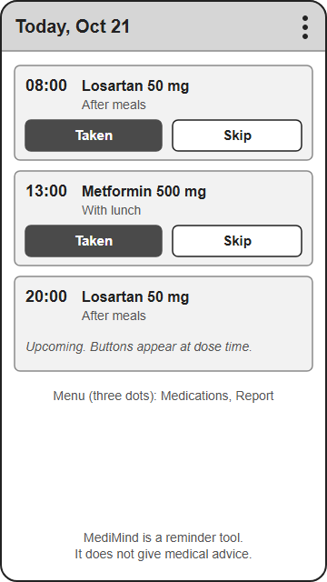
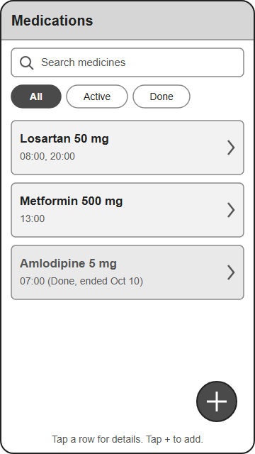
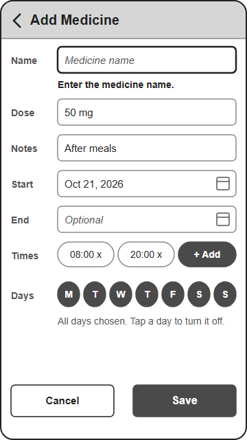
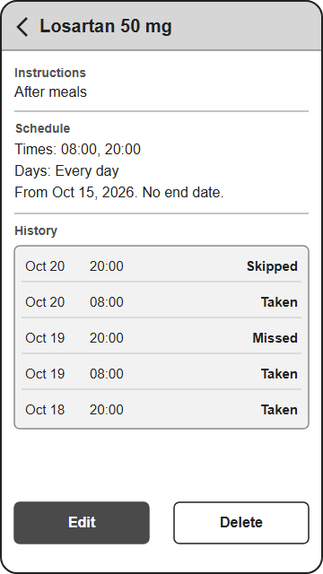
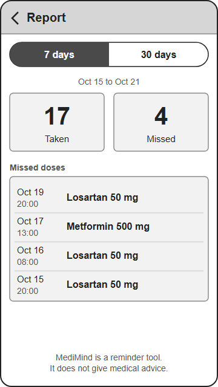
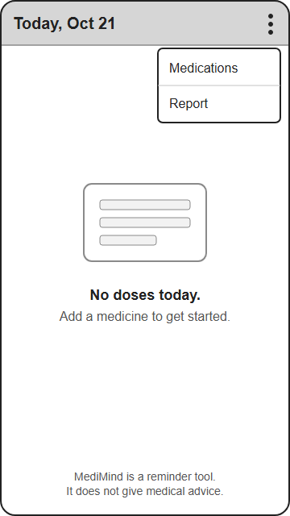

# MediMind Wireframes (Draft)

**Status:** draft for the group to review. These images replace the text sketches in section 9 of `PROPOSAL.md`. The instructor has not approved the proposal yet.

The wireframes are plain grayscale drawings of a 360 x 640 phone screen. The sample medicines and dates are made up. Screen names, buttons and messages match `PROPOSAL.md` and `DESIGN_DETAIL.md`. The SVG files are the source. The PNG files are copies of them.

## 1. Today

The user sees today's doses and taps Taken or Skip on each one that is due. The three-dot menu opens Medications or Report, and tapping a reminder notification also opens this screen.

## 2. Medications

The user searches the list and filters it by All, Active or Done. Tapping a row opens Medication Detail, and the + button opens the Medication Form in add mode.

## 3. Medication Form

The user fills in the name, dose, notes, start date, optional end date, times and weekdays, then taps Save. Save returns to Medications or Detail, and Cancel returns without saving.

## 4. Medication Detail

The user reads the schedule and the intake history of one medicine. Edit opens the Medication Form with the same medicine, and Delete asks for confirmation and then returns to Medications.

## 5. Report

The user switches between the last 7 and 30 days and reads the taken and missed numbers and the list of missed doses. The back arrow returns to Today.

## 6. Empty State (Today)

When no doses are due, Today shows "No doses today. Add a medicine to get started." The open menu shows how to reach Medications to add the first medicine.

## Notes for the Group

- The Taken and Skip buttons are hidden for upcoming doses (`DESIGN_DETAIL.md`, section 5).
- The Form shows the "Enter the medicine name." error as an example. The other messages are in `DESIGN_DETAIL.md`, section 6.
- The Delete confirmation dialog (M-C1) and the Medications empty states (M-N2 to M-N4) are not drawn yet.
- Fonts and colors are only for layout. The final look is decided during development.
